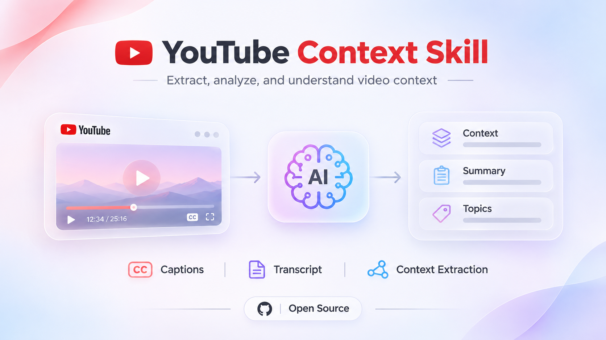

# YouTube Context

## English

An Agent Skills-compatible skill that extracts YouTube video metadata and captions, creates indexed Markdown, and analyzes the content on request.

### Installation

Install Python 3.9 or later with pip. Download this repository and run `python install.py --agent all` from the repository directory. Use `python3` if needed. To install for one agent, choose `--agent codex`, `--agent opencode`, or `--agent claude`. Add `--force` to update an existing installation. Restart the agent afterward.

If yt-dlp is missing, it is installed automatically in the user cache on first use. Installation requires pip and an internet connection. Python must already be installed. When captions are unavailable, the agent can run the script with `--transcribe-audio`. This also installs faster-whisper and downloads its speech model on first use. Processing runs on your computer and can take time.

The skill follows the Agent Skills format. The installer supports Codex, OpenCode, and Claude Code. ChatGPT support and script execution depend on the available integration and environment. The local installer does not install a skill in your ChatGPT account.

Send a YouTube link and request an analysis. The skill retrieves available metadata and captions and creates Markdown with an index, timestamps, and a topic map. The agent adds a summary grounded in the transcript. Automatic captions may contain errors. If captions are unavailable, the skill reports the limitation.

Run the extractor directly with `python skills/youtube-context/scripts/extract.py URL --output video.md --language pt`.

## Português brasileiro

Uma skill para transformar um vídeo do YouTube em contexto consultável em Markdown e responder perguntas com base na transcrição.

### Instalação

Instale Python 3.9 ou superior com pip. Baixe este repositório e, na pasta dele, execute `python install.py --agent all`. Use `python3` se necessário. Para instalar individualmente, escolha `--agent codex`, `--agent opencode` ou `--agent claude`. Para atualizar uma instalação existente, acrescente `--force`. Reinicie o agente depois da instalação.

O yt-dlp é instalado automaticamente num cache do usuário na primeira execução, se estiver ausente. A instalação exige internet e pip. O Python precisa estar instalado previamente. Quando não houver legendas, o agente pode executar o script com `--transcribe-audio`. Nessa opção, instala-se também o faster-whisper e baixa-se o modelo de fala na primeira execução. O processamento acontece no computador e pode demorar.

O formato segue o padrão Agent Skills. O instalador atende Codex, OpenCode e Claude Code. A instalação no ChatGPT e a execução de scripts dependem da integração e do ambiente disponíveis, e não são feitas pelo instalador local.

Envie um link do YouTube e peça uma análise. A skill busca metadados e legendas disponíveis e cria um arquivo Markdown com índice, tempos e um mapa dos assuntos. O agente acrescenta um resumo fundamentado na transcrição. Legendas automáticas podem conter erros. Quando o YouTube não disponibiliza legendas, a skill informa a limitação.

Para usar o extrator diretamente, execute `python skills/youtube-context/scripts/extract.py URL --output video.md --language pt`.
